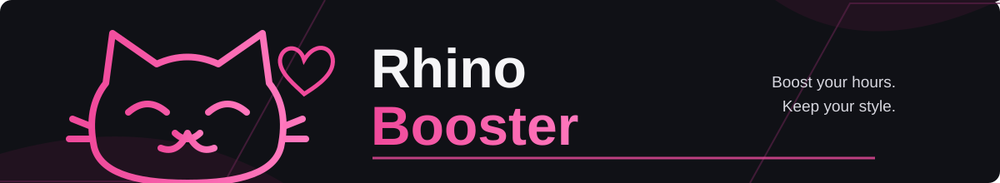

# Rhino Booster

A Windows app for collecting Steam trading cards, banking playtime, and managing achievements without keeping the Steam client open.

[](https://www.microsoft.com/windows)
[](https://www.electronjs.org/)
[](https://github.com/Soraaaaaaaaaaa/Rhino-Booster/releases/latest)

## 🔐 Security — check the download

Before running the installer, you can look up its file hash on VirusTotal:

**RhinoBoost-Setup-v4.4.3.exe**

[**View this file on VirusTotal →**](https://www.virustotal.com/gui/file/8b0a69b804d3dc0b09e23589c793ee6452827c13cb7e7dc472630013eb5c2d11)

**SHA-256**
```
8b0a69b804d3dc0b09e23589c793ee6452827c13cb7e7dc472630013eb5c2d11
```

The link opens the VirusTotal report for this exact hash. Review the results yourself before running the file. A VirusTotal result is a useful check, not a guarantee that a file is safe.

To verify the file you downloaded on Windows, open PowerShell in its folder and run:

```powershell
Get-FileHash .\RhinoBoost-Setup-v4.4.3.exe -Algorithm SHA256
```

Make sure the hash printed by PowerShell matches the one above. If it does not match, do not assume it is the same file.

---

## ✨ Features

- **Trading card farming** — collect eligible Steam trading card drops.
- **Hour Booster** — bank playtime for supported games.
- **Achievement manager** — manage achievements for supported games.
- **Background operation** — use supported features without keeping the Steam client open.
- **Custom interface** — a clean dark theme with hot-pink Rhino Booster branding.

Feature availability depends on the app version and Steam's systems.

## 📥 Download

Head to the [**Releases page**](https://github.com/Soraaaaaaaaaaa/Rhino-Booster/releases) and download the latest version.

For version 4.4.3, the Windows installer is:

`RhinoBoost-Setup-v4.4.3.exe`

If a portable ZIP is provided with the release, download and extract it, then follow any included instructions.

## 🚀 Installation

1. Download the installer from the [Releases page](https://github.com/Soraaaaaaaaaaa/Rhino-Booster/releases).
2. (Recommended) Check its SHA-256 hash using the instructions in the security section above.
3. Run the installer and follow the setup steps.
4. Open Rhino Booster.

Only download builds from a source you trust, and review the security report before running them.

## 🛠️ Build from source

You'll need Windows, [Node.js](https://nodejs.org/), and npm.

```bash
git clone https://github.com/Soraaaaaaaaaaa/Rhino-Booster.git
cd Rhino-Booster
npm install
npm run build
```

The build output is created according to the project's build configuration.

## 📸 Screenshots

App screenshots will be added here.

## ⚠️ Disclaimer

Rhino Booster is an independent project and is not affiliated with, endorsed by, or sponsored by Valve Corporation. Steam and related trademarks belong to their respective owners.

Use the app responsibly and make sure your use follows the [Steam Subscriber Agreement](https://store.steampowered.com/subscriber_agreement/).

---

Made with 💗 for Windows.
